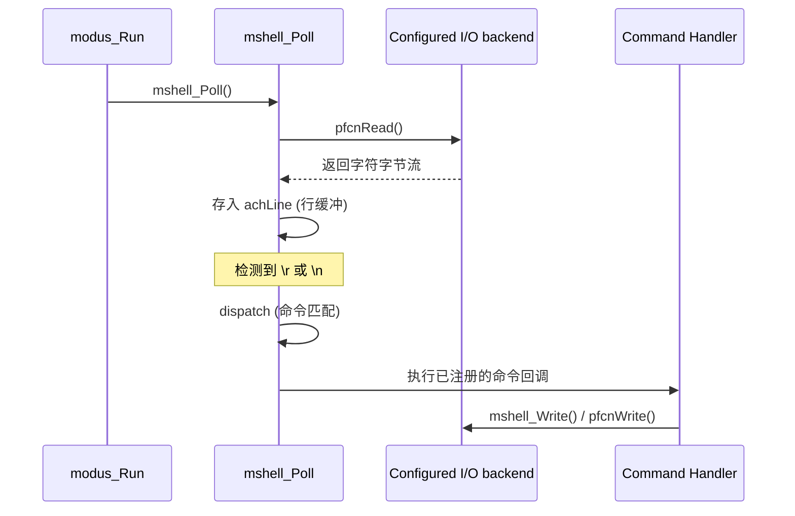

# MODUS 极简调试 Shell (mshell) 进阶指南

`mshell` 是 MODUS 提供的命令交互系统，其设计的核心目标是 **“零手动配置”** 与 **“低资源占用”**。

---

## 1. 自动初始化内核

`mshell` 之所以能做到开箱即用，是因为它利用了链接器段（Linker Section）技术。

### 1.1 `init_infos` 自动发现
通过 `MODUS_SHELL_CMD` 宏注册命令时，预处理器会生成一个静态结构体并将其强行放入名为 `init_infos` 的特殊段中。在 `modus_Init()` 执行期间，框架会遍历此段中的所有项，自动调用 `mshell_RegisterCmd` 完成注册。

### 1.2 BSS 与延迟初始化
- **物理内存**：`mshell` 的所有核心变量（命令表、行缓冲区）都位于 BSS 段，由 C 启动代码自动清零。
- **逻辑激活**：在 `modus_Run()` 第一次触发 `mshell_Poll()` 时，系统会自动绑定 RTT IO 后端并加载 `help/ver/list` 等内置命令。

---

## 2. 自定义 I/O 后端 (UART/USB/BT)

`mshell` 的一大优势是它不硬绑定 RTT。通过使用 `mshell_SetIO()`，你可以将 Shell 迁移至 UART、USB-CDC 甚至蓝牙串口。

### 2.1 实现 I/O 适配器
你需要定义一个 `mshell_io_t` 结构体，包含非阻塞读取函数和发送函数：

```c
/* 1. 实现底层回调 (以 UART 为例) */
static unsigned my_uart_read(char *pchBuf, unsigned hwSize) {
    // 关键：必须是非阻塞的，没有数据立即返回 0
    return UART_Receive_NonBlock(pchBuf, hwSize);
}

static void my_uart_write(const char *pchBuf, unsigned hwSize) {
    UART_Send_Block(pchBuf, hwSize);
}

/* 2. 定义 IO 对象 */
static const mshell_io_t s_tMyUART_IO = {
    .pfcnRead  = my_uart_read,
    .pfcnWrite = my_uart_write,
};

/* 3. 在 Poll 调用前注入 (如 main 初始化阶段) */
int main(void) {
    // init hardware
    
    mshell_SetIO(&s_tMyUART_IO); // 覆盖默认的 RTT 通道
    modus_Init(&s_tModus);
    
    while(1) {
        modus_Run();
    }
}
```

### 2.2 注意事项
- **非阻塞原则**：`pfcnRead` 绝对**不能等待**数据。如果它由于等待输入而阻塞，整个系统的滴答和任务都会停摆。
- **静态生存期**：传递给 `SetIO` 的结构体指针必须指向一个全局或静态变量，因为 `mshell` 会在运行期持续引用它。

---

## 3. 命令参数解析

命令回调收到命令名后的只读参数字符串。MShell 提供游标解析 API，
解析器只读输入，不分配内存。游标和 token 指向回调参数，不能在回调
返回后保存。

```c
static void cmd_level(const char *args)
{
    const char *cursor = args;
    uint32_t level = 0U;
    mshell_parse_result_t result = mshell_Parse(&cursor, &level);

    if (result != MSHELL_PARSE_OK || !mshell_AtEnd(cursor)) {
        mshell_Write("Usage: level <0..100>\r\n");
        return;
    }
    if (level > 100U) {
        mshell_Write("level must be 0..100\r\n");
        return;
    }
    /* Apply the application-specific level here. */
}

MODUS_SHELL_CMD(level, cmd_level, "Set level: level <0..100>");
```

`mshell_Parse()` 根据目标指针类型选择有符号整数、无符号整数或 bool
解析函数。它是 C11 `_Generic` 便捷入口。明确类型的底层函数
（如 `mshell_ParseUint32()`）可在 C99 或 C++ 调用处直接使用。

普通整数按十进制解析，前导零不表示八进制；无符号数不接受正负号。
需要十六进制时显式使用 `mshell_ParseHex()`，接受裸十六进制或 `0x`
前缀。`mshell_ParseBool()` 接受小写 `true/false`、`on/off` 和 `1/0`。
数值转换会检查完整 token 和目标类型范围；`OK`、`END`、`INVALID`、
`RANGE`、`BAD_ARGUMENT` 分别表示成功、没有参数、格式错误、超范围和
调用参数错误。

每次解析失败都保持该次调用的游标和输出值。解析多参数命令时，先将值
读入局部变量，所有解析、尾部参数和业务范围检查通过后再执行动作。
`mshell_ConsumeWord()` 用于完整匹配子命令，`mshell_NextToken()` 返回
不带 NUL 终止符的字符串视图，`mshell_AtEnd()` 用于拒绝多余参数。
这些解析函数统一把空格和 Tab 视为分隔符。

使用 `mshell_Write()` 向当前 Shell 后端发送 NUL 结尾字符串。回复不受
日志等级掩码控制，也不依赖 RTT；未设置可用 IO 时不输出。它不提供
格式化功能，带数值的日志仍可按需使用现有日志接口。

---

## 4. 深入理解 RTT 控制块

`mshell` 的数据交互依赖于 SEGGER RTT 的核心数据结构 `SEGGER_RTT_CB`（控制块）。

### 4.1 控制块结构
在中端侧，RTT 控制块被定义为：
```c
typedef struct {
  char                    acID[16];          // 魔法字符串 "SEGGER RTT"
  int                     MaxNumUpBuffers;   // 上行通道总数
  int                     MaxNumDownBuffers; // 下行通道总数
  SEGGER_RTT_BUFFER_UP    aUp[N];            // 发送缓存描述符
  SEGGER_RTT_BUFFER_DOWN  aDown[N];          // 接收缓存描述符
} SEGGER_RTT_CB;
```
`mshell` 默认复用的是 **Channel 0**（Terminal）。其底层缓存大小分别由
`BUFFER_SIZE_UP` 和 `BUFFER_SIZE_DOWN` 配置，默认值为 1024 和 64 字节。
缓存由 `SEGGER_RTT.c` 静态分配并在控制块中绑定。

### 4.2 调试器如何找到它？
调试器（如 J-Link）连接芯片后，会在 RAM 中全速搜索 `"SEGGER RTT"` 字符串。一旦找到，它就能读取 `aUp` 和 `aDown` 的指针及其读写偏移量（RdOff/WrOff），从而实现无需 CPU 干预的数据搬运。

---

## 5. I/O 调用流分析

`mshell` 的运行遵循严格的非阻塞轮询机制：



**关键点：**
- **Shell UI 输入/输出**：经过当前配置的 `mshell_io_t`；默认配置可使用 RTT，
  自定义配置可使用 UART、USB CDC 或其他字节流。Shell 回复不经过日志过滤。
- **并发安全**：RTT 通道的 `RdOff` 和 `WrOff` 被声明为 `volatile`，确保了 PC 端（通过 SWD 修改）和 MCU 端修改的可见性。

---

## 6. 缓冲区对比 (开发者关注)

| 缓冲区 | 角色 | 大小 | 备注 |
| :--- | :--- | :--- | :--- |
| **`_acUpBuffer`** | RTT 驱动层发送缓存 | 1024 Byte | 位于 `SEGGER_RTT.c`，承载控制台所有输出。 |
| **`_acDownBuffer`** | RTT 驱动层接收缓存 | 64 Byte 默认 | `BUFFER_SIZE_DOWN` 可覆盖。 |
| **`achLine`** | Shell 应用层行缓存 | 64 Byte 含 NUL | `MSHELL_LINE_SIZE` 可覆盖，默认最多接收 63 字节。超长行整行丢弃，不执行其前缀。 |

Tab 会进入行缓冲并作为参数分隔符。行缓存满后，Shell 会忽略后续字符，
直到收到换行，再报告超长并恢复接收下一条命令。

---

## 7. 重要原则

> [!IMPORTANT]
> **I/O 非阻塞原则**：
> 在手动实现 `mshell_io_t` 时，`pfcnRead` **必须** 立即返回 0（如果没有字符）。任何形式的阻塞读取都会导致整个 MODUS 调度循环挂起。
